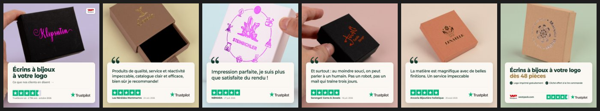

# Trustpilot-karrusel til Meta

Westpacks faste skabelon til en Meta-karrusel med Trustpilot-anmeldelser. Grafikken er altid den samme, og kun data skifter:
sprog, billeder, anmeldelser og TrustScore. Første version er den franske karrusel, der blev godkendt 27/10/2026 (PH - AD26 i banken).



## Sådan ser den ud – og det ændres ikke

- **Kort 1:** en kundes smykkeæske med deres eget logo og overskriften «&nbsp;Écrins à bijoux à votre logo&nbsp;» (på
  hvert sprog). Under den står TrustScore, antal anmeldelser og måned med store Trustpilot-stjerner og -logo.
  Westpack-logoet sidder øverst til højre.
- **Kort 2–5 (1–8 kort):** én anmeldelse pr. kort, ordret. Anførselstegnet sidder på kanten af det lyse kort. I bunden
  står stjerner, virksomhedens navn, dato og Trustpilot-logo.
- **Sidste kort:** tilbuddet – «&nbsp;… dès 48 pièces&nbsp;», gratis logotryk og gratis cliché ved første ordre.
  Nederst Westpack-logo, westpack.com og Trustpilot.
- Billedet fylder hele kortet. Anmeldelseskortet ligger på det rene papir under æsken.
- Er en tekst for lang på et andet sprog, gør skabelonen den mindre inden for faste grænser. Kan den stadig ikke være
  der, nægter den at rendere og siger hvilket kort og hvilken tekst.

## Lav en ny version

1. **Hent anmeldelser.** Trustpilot Business → Administrér anmeldelser → Serviceanmeldelser → Indbakke → eksportér
   (en UTF-16-fil). Filtrér på sproget. **Eksporten indeholder anmeldernes e-mailadresser – læg den aldrig i repoet.**
2. **Vælg 3–4 anmeldelser** (reglerne står nedenfor). Brug virksomhedsnavne, ikke privatpersoners fulde navn.
3. **Vælg billeder.** `photos/` indeholder serien "Kundebilleder Uge 40": kunders smykkeæsker med deres eget logo.
   Seriens 1x1-version kører allerede i AD12 Kundelogoer. Andre billeder skal være 9:16-studiebilleder på ensfarvet
   baggrund, så papiret under æsken kan bære anmeldelseskortet. Undgå æsker med en læsbar webadresse – den reklamerer
   for en anden butik (derfor er Kundelogo-05 ikke med).
4. **Kopiér en spec** i `specs/` og ret sprog, TrustScore, anmeldelser og billeder:

   ```json
   {
     "id": "de-schmuck-2026-11",
     "locale": "de",
     "trustpilot": { "score": 4.6, "reviews": 2796, "asOf": "2026-10" },
     "hero":  { "photo": { "src": "photos/kundelogo-02.jpg", "y": -600 } },
     "quotes": [
       { "text": "…ordret…", "author": "Navn som på Trustpilot", "date": "2026-10-24", "stars": 5,
         "photo": { "src": "photos/kundelogo-01.jpg" } }
     ],
     "offer": { "photo": { "src": "photos/kundelogo-03.jpg" } }
   }
   ```

   - `locale`: `fr`, `de`, `it`, `en` (EU-shop), `en-uk`, `en-us`. Teksten for hvert sprog ligger i `locales.js`.
   - `photo.y` flytter billedet op og ned (standard −640; mindre negativt = æsken længere nede).
     `photo.zoom` (standard 1080) gør billedet større.
   - `text` i en spec kan overskrive en enkelt tekst fra `locales.js`, fx `{ "text": { "hero": { "sub": "…" } } }`.
5. **Render og tjek citaterne:**

   ```
   node templates/meta-trustpilot-carousel/render.js templates/meta-trustpilot-carousel/specs/<fil>.json --reviews=<eksport>
   ```

   Kortene lander i `out/<id>/` (card-01.png … og sheet.png med alle side om side). Skabelonen nægter, hvis et citat ikke
   står ordret i eksporten, hvis datoen eller stjernerne ikke passer, eller hvis en tekst ikke kan være der.
6. **Læg den i Meta (altid pauset):**

   ```
   node templates/meta-trustpilot-carousel/publish.js templates/meta-trustpilot-carousel/specs/<fil>.json --adset=<id> --name="AD27 - Avis Trustpilot - Karrusel - de_DE"
   ```

   `--dry-run` viser teksterne uden at oprette noget. Annoncen oprettes **pauset** og tændes i Ads Manager. Scriptet
   nægter, hvis spec'en er ændret siden renderingen, eller hvis navnet allerede findes i ad settet.

## Reglerne (Trustpilot og Westpack)

- **Citater er ordrette.** Uddrag må forkortes, men skal starte, hvor en sætning starter i originalen. Der må ikke laves
  et stort bogstav for at få det til at ligne en sætning. Det var derfor, Serengeti-citatet blev "Et surtout : au moindre
  souci…".
- **Tallet står altid med ordet "TrustScore"**, antal anmeldelser og måned. Trustpilots logo er med på hvert kort.
- **"Excellent"** (Hervorragend, Eccezionale …) er Trustpilots ord for 4,3 og derover. Under det skal `trustpilot.label`
  være Trustpilots eget ord.
- **Ingen sammenligning** med andre virksomheders score, og **ikke kun 5-stjernede** anmeldelser på en måde, der vildleder.
  Første kort viser den samlede TrustScore.
- **Tjek at anmeldelserne stadig ligger på Trustpilot**, før annoncen tændes. Anmelderen ejer og kan slette dem.
- **Billedet og citatet er to forskellige kunder.** Navnene er tydeligt forskellige, så kortet læses som "endnu en
  kunde" og ikke som anmelderens egen æske. Hvis en anmelder har sendt billeder af sin egen æske, så brug dem.
- **Tilbudskortet gælder smykkeæsker.** Gratis logotryk står kun på shoppen for smykkeæsker. Brug ikke skabelonen
  til poser eller andre kategorier uden nye tekster.

## Meta-indstillingerne (låst i publish.js)

Kortenes rækkefølge er låst (ikke "vis bedste kort først"), der er intet slutkort, og hvert kort har knappen "Læs mere".
Alle Advantage+-funktioner, der omskriver tekst, laver nye CTA'er eller ændrer billeder, er slået fra. Det er også dem,
der kan sætte en "See offer"-knap på.

- **Instagram** viser kort 1's overskrift over primærteksten. Derfor åbner teksten med "Ce sont nos clients…" og
  gentager ikke produktet.
- **Facebook** viser kun ca. 10–14 tegn af kortoverskriften ved siden af knappen. Derfor er de korte ("Avis 5 étoiles").

## Sprogene

| Sprog | Status | Link |
|---|---|---|
| `fr` | Godkendt (AD26) | eur_eu_fra/ecrins-a-bijoux.html |
| `de` | Udkast | eur_eu_ger/schmuckschachteln.html |
| `it` | Udkast | eur_eu_ita/astucci-per-gioielli.html |
| `en` / `en-uk` | Udkast | eur_eu_eng / gbp_uk_eng jewellery-boxes.html |
| `en-us` | Udkast | usd_us_eng/jewelry-boxes.html |

Alle påstande på tilbudskortet er læst på hvert lands egen shop 27/10/2026 (se `sources` i `locales.js`). Teksten på
udkastene skal læses af en, der taler sproget, før den kører. Render-scriptet minder om det.

Logotryk er gratis på **alle** smykkeæsker uanset materiale (bekræftet 27/10/2026). Den italienske kategoriside skriver
"de fleste", men det gælder alle. Det gælder stadig kun smykkeæsker: poser, pochoner og flade æsker kan koste et tillæg.

`en-us` har told på tilbudskortet ("US duties included at checkout") i stedet for den gratis prægeplade, fordi told er det
store spørgsmål for en amerikansk køber. Påstanden står i US-shoppens topbjælke og i bloggen /usd_us_eng/blog/us-orders.

## Filer

- `carousel.html` – designet. Kan åbnes gennem en lokal server: `carousel.html?spec=specs/<fil>.json`.
- `carousel-spec.js` – laver en spec om til alle tekster på kortene og i Meta, og tjekker citaterne mod eksporten.
  Bruges af både browser og scripts.
- `locales.js` – alle tekster pr. sprog.
- `render.js`, `publish.js` – render til PNG / læg i Meta pauset. Kræver Playwright i `tmp/playwright-runner` og
  Microsoft Edge.
- `photos/`, `assets/` – billeder samt Trustpilots officielle logo og stjerner (cdn.trustpilot.net/brand-assets/4.1.0).
- `specs/` – én fil pr. version. `out/` er renderet output og gemmes ikke i git.
- Tests: `node --test tests/meta-trustpilot-carousel.test.js`.
